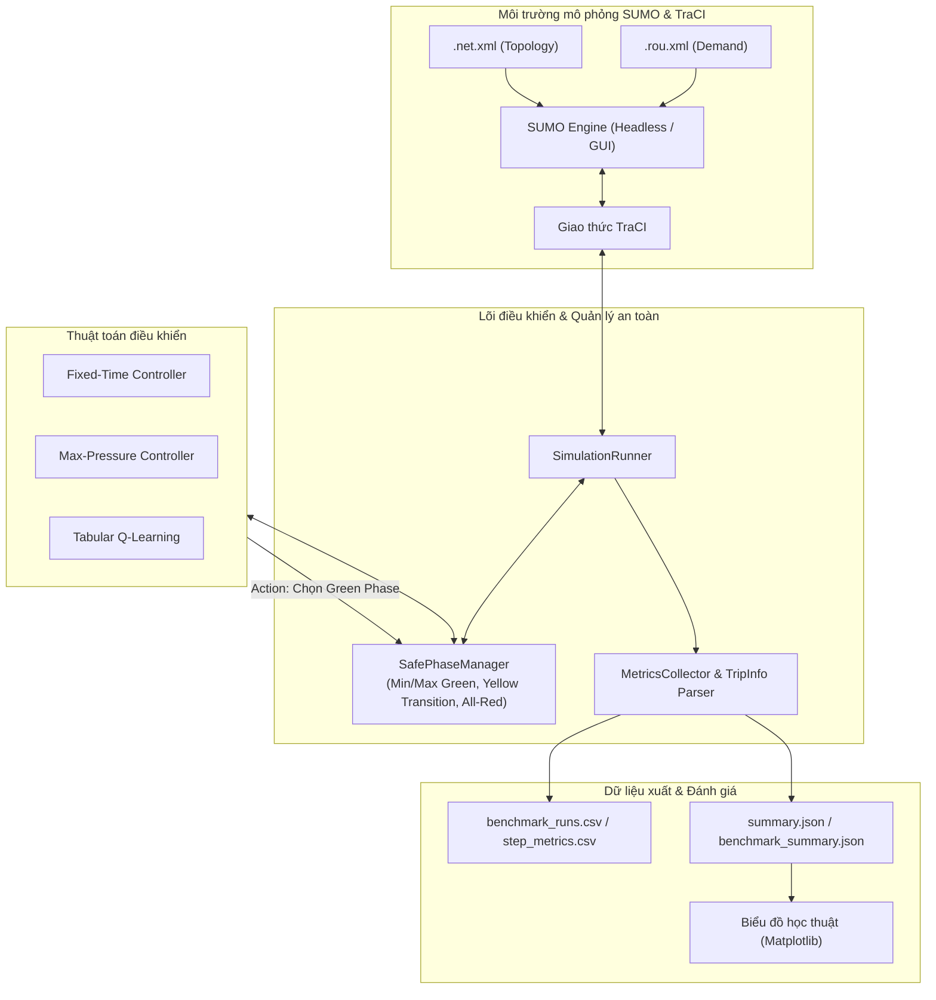

# TrafficSignalControl: SUMO Reinforcement Learning & Baseline Benchmark

[](https://www.python.org/)
[](https://eclipse.dev/sumo/)
[](file:///tests)
[](LICENSE)

Nền tảng mô phỏng và đánh giá đối chuẩn (Benchmarking) các thuật toán điều khiển tín hiệu đèn giao thông thích ứng (**Adaptive Traffic Signal Control - ATSC**) trên môi trường **Eclipse SUMO** (Simulation of Urban MObility) thông qua giao thức **TraCI**, tích hợp các kịch bản chuẩn thuộc bộ dữ liệu **RESCO** (Reinforcement Learning Benchmarks for Traffic Signal Control).

---

## Mục lục
1. [Giới thiệu & Tính năng nổi bật](#1-giới-thiệu--tính-năng-nổi-bật)
2. [Kiến trúc hệ thống](#2-kiến-trúc-hệ-thống)
3. [Các thuật toán tích hợp](#3-các-thuật-toán-tích-hợp)
4. [Tập dữ liệu chuẩn RESCO](#4-tập-dữ-liệu-chuẩn-resco)
5. [Cấu trúc thư mục dự án](#5-cấu-trúc-thư-mục-dự-án)
6. [Cài đặt & Chuẩn bị môi trường](#6-cài-đặt--chuẩn-bị-môi-trường)
7. [Hướng dẫn sử dụng CLI](#7-hướng-dẫn-sử-dụng-cli)
   - [7.1. Kiểm tra thông tin kịch bản (Dataset Inspection)](#71-kiểm-tra-thông-tin-kịch-bản-dataset-inspection)
   - [7.2. Chạy mô phỏng điều khiển (Simulation Execution)](#72-chạy-mô-phỏng-điều-khiển-simulation-execution)
     - [7.2.1. Chạy dòng lệnh không đồ họa (Headless Mode)](#721-chạy-dòng-lệnh-không-đồ-họa-headless-mode)
     - [7.2.2. Chạy giao diện trực quan với SUMO-GUI (--gui, --gui-delay)](#722-chạy-giao-diện-trực-quan-với-sumo-gui---gui---gui-delay)
   - [7.3. Huấn luyện Agent Học tăng cường (RL Training)](#73-huấn-luyện-agent-học-tăng-cường-rl-training)
   - [7.4. Đánh giá Agent độc lập (RL Evaluation)](#74-đánh-giá-agent-độc-lập-rl-evaluation)
   - [7.5. Chạy Benchmark ma trận đối chuẩn (Benchmark Evaluation)](#75-chạy-benchmark-ma-trận-đối-chuẩn-benchmark-evaluation)
   - [7.6. Tổng hợp báo cáo & Tạo biểu đồ học thuật](#76-tổng-hợp-báo-cáo--tạo-biểu-đồ-học-thuật)
8. [Hệ thống cấu hình (Configuration)](#8-hệ-thống-cấu-hình-configuration)
9. [Chỉ số đánh giá (Evaluation Metrics)](#9-chỉ-số-đánh-giá-evaluation-metrics)
10. [Kiểm thử tự động (Test Suite)](#10-kiểm-thử-tự-động-test-suite)
11. [Khắc phục sự cố thường gặp (Troubleshooting)](#11-khắc-phục-sự-cố-thường-gặp-troubleshooting)

---

## 1. Giới thiệu & Tính năng nổi bật

- **Tích hợp 3 thuật toán chuẩn mực**: Hỗ trợ 2 phương pháp kinh điển (**Fixed-Time 30s**, **Max-Pressure Heuristic**) và phương pháp Học tăng cường (**Tabular Q-Learning**).
- **Hỗ trợ giao diện đồ họa SUMO-GUI trực quan**: Chuyển đổi linh hoạt giữa chế độ dòng lệnh Headless tốc độ cao (benchmark, training) và chế độ trực quan **SUMO-GUI** (`--gui`, `--gui-delay`) để xem từng xe di chuyển, chuyển làn và chu kỳ đèn giao thông theo thời gian thực.
- **Bộ quản lý an toàn pha đèn (Safe Phase Manager)**: Tự động chèn pha vàng dọn nút (*Yellow clearance transition*) và pha đỏ toàn phần (*All-red clearance*), đảm bảo thời gian đèn xanh tối thiểu (`min_green >= 5s`) và tối đa (`max_green <= 60s`), ngăn ngừa chuyển pha đột ngột gây tai nạn trong mô phỏng.
- **Phân tách nhịp điều khiển (Decoupled Cadence)**: Tách biệt nhịp quyết định của baseline (1.0s để tránh hiện tượng dãn chu kỳ) và agent RL (5.0s theo chuẩn RESCO).
- **Thu thập dữ liệu thực tế chính xác (Ground-truth Tripinfo)**: Phân tích trực tiếp tệp `--tripinfo-output` chuẩn của SUMO để đo lường thời gian trễ, thời gian chờ, quãng đường di chuyển và vận tốc thực tế của từng phương tiện.
- **Hệ thống đánh giá khoa học & Tự động hóa**: Khung thực nghiệm ma trận đa kịch bản (`cologne1`, `ingolstadt1`), đa thuật toán, đa seed (`42`, `101`, `2024`), thống kê mẫu không chệch ($ddof=1$) và tự động sinh các báo cáo Markdown cùng biểu đồ so sánh.
- **Chất lượng mã nguồn & Kiểm thử toàn diện**: Bộ kiểm thử tự động với 75 unit tests bao quát các thành phần logic bộ điều khiển, quản lý an toàn chuyển pha, hạch toán chỉ số, nạp cấu hình và tích hợp mô phỏng TraCI.

---

## 2. Kiến trúc hệ thống



---

## 3. Các thuật toán tích hợp

| Thuật toán | Loại thuật toán | Đặc điểm & Cơ chế hoạt động | Nhịp quyết định (Cadence) |
| :--- | :--- | :--- | :--- |
| **Fixed-Time** | Rule-based (Baseline) | Chu kỳ pha cố định luân phiên tuần hoàn theo thời gian đèn xanh định trước (mặc định 30.0s). Chuyển pha an toàn với vàng/đỏ dọn nút. | 1.0s |
| **Max-Pressure** | Heuristic / Pressure | Tối ưu hóa chênh lệch áp lực hàng đợi giữa các làn vào (*incoming*) và làn ra (*outgoing*). Chọn pha có áp lực giải tỏa lớn nhất, đảm bảo `min_green` và `max_green`. | 1.0s |
| **Tabular Q-Learning** | Học tăng cường dạng bảng | Rời rạc hóa không gian trạng thái (pha hiện tại, thời gian xanh hiệu dụng, hàng đợi phục vụ/chờ). Cập nhật bảng $Q(s, a)$ với chiến lược $\varepsilon$-greedy và đánh giá greedy định kỳ. | 5.0s |

---

## 4. Tập dữ liệu chuẩn RESCO

Dự án tinh gọn và chuẩn hóa **3 kịch bản trọng tâm** từ bộ dữ liệu [Pi-Star-Lab/RESCO](https://github.com/Pi-Star-Lab/RESCO) nhằm tối ưu hiệu năng tính toán và đại diện cho các mô hình hình học nút giao khác nhau:

| Tên Dataset | Số nút giao (TLS) | Số pha xanh / Actions | Cửa sổ quan sát (s) | Nhu cầu trong cửa sổ | Mô tả mạng lưới | Giấy phép |
| :--- | :---: | :---: | :---: | :---: | :--- | :--- |
| `cologne1` | 1 | 8 pha xanh | [25200.0, 28800.0) (3600s) | 2,015 xe | Nút giao đơn thực tế tại Cologne (TAPAS Cologne) | CC BY-NC-SA 3.0 |
| `ingolstadt1` | 1 | 3 pha xanh | [57600.0, 61200.0) (3600s) | 1,716 xe | Nút giao đơn thực tế tại Ingolstadt (InTAS) | GNU GPL v3.0 |
| `cologne3` | 3 | 3, 4, 4 pha tương ứng | [25200.0, 28800.0) (3600s) | 4,494 xe | Tuyến phố gồm 3 nút giao liên tiếp phối hợp | CC BY-NC-SA 3.0 |

> [!NOTE]
> - Số pha xanh và cửa sổ thời gian được trích xuất trực tiếp từ bộ đọc cú pháp mạng lưới [`src/data_inspector.py`](file:///src/data_inspector.py).
> - Chi tiết về nguồn gốc, bản quyền commit SHA và quy trình xác thực dữ liệu được lưu trữ tại [`data/SOURCES.md`](file:///data/SOURCES.md).

---

## 5. Cấu trúc thư mục dự án

```text
TrafficSignalControl/
├── configs/                     # Cấu hình huấn luyện và thử nghiệm (YAML)
│   ├── experiments.yaml         # Cấu hình kịch bản và tham số benchmark đối chuẩn
│   └── q_learning.yaml          # Cấu hình siêu tham số và rời rạc hóa Tabular Q-Learning
├── data/                        # Tập dữ liệu RESCO SUMO (.net.xml, .rou.xml, .sumocfg)
│   ├── cologne1/                # Kịch bản Cologne 1 nút giao (8 pha xanh, 2.015 xe)
│   ├── cologne3/                # Kịch bản Cologne 3 nút giao liên tiếp (4.494 xe)
│   ├── ingolstadt1/             # Kịch bản Ingolstadt 1 nút giao (3 pha xanh, 1.716 xe)
│   └── SOURCES.md               # Tài liệu bản quyền và nguồn dữ liệu RESCO
├── models/                      # Thư mục lưu checkpoint mô hình RL đã huấn luyện (.json)
│   └── q_learning/              # Checkpoints Tabular Q-Learning (*_best.json, *_final.json)
├── results/                     # Kết quả thực nghiệm và trực quan hóa (tự động sinh)
│   ├── evaluation/              # Dữ liệu đối chuẩn (benchmark_runs.csv, benchmark_summary.json, ...)
│   ├── figures/                 # Biểu đồ so sánh chất lượng học thuật (.png)
│   └── training/                # Log quá trình huấn luyện RL (JSON log)
├── src/                         # Mã nguồn chính của nền tảng
│   ├── controllers/             # Các bộ điều khiển tín hiệu đèn giao thông
│   │   ├── base.py              # Lớp BaseTrafficController trừu tượng
│   │   ├── fixed_time.py        # Bộ điều khiển Fixed-Time 30s
│   │   ├── max_pressure.py      # Bộ điều khiển Max-Pressure Heuristic theo làn
│   │   └── q_learning.py        # Bộ điều khiển Tabular Q-Learning
│   ├── evaluation/              # Module đánh giá & đối chuẩn benchmark
│   │   ├── compare_algorithms.py# Tổng hợp kết quả & xuất báo cáo Markdown/JSON
│   │   ├── evaluate_rl.py       # Đánh giá agent RL độc lập ở chế độ greedy
│   │   ├── experiment_runner.py # Trình thực thi ma trận benchmark đa seed
│   │   └── plot_comparison.py   # Bộ sinh biểu đồ trực quan hóa học thuật
│   ├── rl/                      # Thành phần môi trường Học tăng cường
│   │   ├── discretization.py    # Rời rạc hóa không gian trạng thái
│   │   ├── environment.py       # Môi trường Gymnasium-compatible RL Env tích hợp TraCI
│   │   ├── observations.py      # Bộ trích xuất và chuẩn hóa vector quan sát
│   │   └── rewards.py           # Các hàm phần thưởng giao thông (Negative Queue Reward)
│   ├── training/                # Pipeline huấn luyện RL
│   │   └── train_q_learning.py  # Huấn luyện Tabular Q-Learning kèm validation định kỳ
│   ├── config.py                # Nạp và xác thực cấu hình mô phỏng & an toàn
│   ├── data_inspector.py        # Phân tích cú pháp mạng và luồng xe RESCO trong cửa sổ
│   ├── metrics.py               # Thu thập chỉ số và phân tích tripinfo SUMO
│   ├── phase_manager.py         # Quản lý an toàn chuyển pha đèn giao thông (SafePhaseManager)
│   └── runner.py                # Điều phối vòng lặp mô phỏng SUMO/TraCI
├── tests/                       # Toàn bộ bộ kiểm thử tự động (75 unit tests)
├── main.py                      # Điểm vào chính (CLI) của ứng dụng
├── requirements.txt             # Danh sách thư viện Python phụ thuộc
└── README.md                    # Tài liệu hướng dẫn sử dụng dự án
```

---

## 6. Cài đặt & Chuẩn bị môi trường

### 6.1. Yêu cầu hệ thống
- **Hệ điều hành:** Windows 10/11 hoặc Linux (Ubuntu 20.04+)
- **Python:** Phiên bản 3.11 trở lên
- **SUMO:** Phiên bản 1.20.0+ (Khuyến nghị Eclipse SUMO 1.28.0+)

### 6.2. Cài đặt Eclipse SUMO & Thiết lập biến môi trường
Tải và cài đặt SUMO từ trang chính thức [Eclipse SUMO Download](https://eclipse.dev/sumo/).

**Trên Windows (PowerShell):**
```powershell
# Kiểm tra SUMO đã được nhận diện trong PATH chưa
sumo --version

# Nếu chưa cấu hình biến môi trường SUMO_HOME:
[System.Environment]::SetEnvironmentVariable('SUMO_HOME', 'C:\Program Files (x86)\Eclipse\Sumo', 'User')
$env:SUMO_HOME = "C:\Program Files (x86)\Eclipse\Sumo"
```

**Trên Linux:**
```bash
sudo add-apt-repository ppa:sumo/stable
sudo apt-get update
sudo apt-get install sumo sumo-tools sumo-doc
export SUMO_HOME="/usr/share/sumo"
```

### 6.3. Khởi tạo môi trường ảo Python & Cài đặt thư viện
```powershell
# 1. Tạo môi trường ảo Python
python -m venv .venv

# 2. Kích hoạt môi trường ảo
# Trên Windows PowerShell:
.\.venv\Scripts\Activate.ps1
# Trên Linux/macOS:
source .venv/bin/activate

# 3. Nâng cấp pip và cài đặt dependencies
pip install --upgrade pip
pip install -r requirements.txt
```

---

## 7. Hướng dẫn sử dụng CLI

Giao diện dòng lệnh [`main.py`](file:///main.py) hỗ trợ đầy đủ các tham số điều khiển và chạy mô phỏng.

### 7.1. Kiểm tra thông tin kịch bản (Dataset Inspection)
Trích xuất thông tin cấu hình mạng, danh sách nút giao, số pha đèn và tổng nhu cầu luồng xe:
```powershell
# Kiểm tra một kịch bản cụ thể
python main.py --inspect --dataset cologne1
python main.py --inspect --dataset ingolstadt1

# Kiểm tra tổng quan toàn bộ 3 kịch bản có sẵn
python main.py --inspect-all
```

### 7.2. Chạy mô phỏng điều khiển (Simulation Execution)

Nền tảng hỗ trợ 2 chế độ vận hành: **Headless (mặc định)** để chạy nền tốc độ cao và **SUMO-GUI (`--gui`)** để theo dõi trực quan mô phỏng.

#### 7.2.1. Chạy dòng lệnh không đồ họa (Headless Mode)
Chế độ mặc định tối ưu hiệu năng tính toán, thích hợp cho benchmark và xử lý hàng loạt:

##### A. Thuật toán Fixed-Time (Đèn xanh cố định 30s):
```powershell
python main.py --dataset cologne1 --algorithm fixed-time --fixed-time-green 30.0 --tripinfo
```

##### B. Thuật toán Max-Pressure (Áp lực hàng đợi):
```powershell
python main.py --dataset ingolstadt1 --algorithm max-pressure --pressure-metric queue --tripinfo
```

##### C. Agent Học tăng cường (Q-Learning) với checkpoint:
```powershell
# Chạy Q-Learning với checkpoint đã huấn luyện
python main.py --dataset cologne1 --algorithm q-learning --model models/q_learning/q_learning_cologne1_best.json --tripinfo
```

##### D. Chạy thử nghiệm agent Q-Learning chưa qua huấn luyện (`--allow-untrained`):
```powershell
python main.py --dataset cologne1 --algorithm q-learning --allow-untrained --tripinfo
```

---

#### 7.2.2. Chạy giao diện trực quan với SUMO-GUI (`--gui`, `--gui-delay`)
Thêm cờ `--gui` vào bất kỳ lệnh nào của `main.py` để mở trực tiếp cửa sổ mô phỏng **SUMO-GUI**.

> [!TIP]
> **Điều chỉnh tốc độ hiển thị mô phỏng:**
> - Mặc định TraCI chạy ở tốc độ CPU tối đa khiến các xe lướt qua rất nhanh. Thêm cờ `--gui-delay <ms>` (ví dụ `--gui-delay 50` hoặc `100` ms) để làm chậm nhịp hiển thị giữa các bước mô phỏng, giúp quan sát các pha đèn đổi màu và dòng xe di chuyển mượt mà.
> - Bạn cũng có thể điều chỉnh trực tiếp ô **Delay (ms)** ở thanh công cụ góc trên của cửa sổ SUMO-GUI bất kỳ lúc nào khi đang chạy.

##### A. Xem mô phỏng Fixed-Time trên SUMO-GUI:
```powershell
python main.py --dataset cologne1 --algorithm fixed-time --gui --gui-delay 50 --steps 500
```

##### B. Xem mô phỏng Max-Pressure trên SUMO-GUI:
```powershell
python main.py --dataset ingolstadt1 --algorithm max-pressure --gui --gui-delay 50 --steps 500
```

##### C. Xem agent Học tăng cường (Q-Learning) điều khiển trên SUMO-GUI:
```powershell
python main.py --dataset cologne1 --algorithm q-learning --model models/q_learning/q_learning_cologne1_best.json --gui --gui-delay 50
```

##### D. Thử nghiệm nhanh agent RL chưa huấn luyện trên SUMO-GUI:
```powershell
python main.py --dataset cologne1 --algorithm q-learning --allow-untrained --steps 300 --gui --gui-delay 50
```

---

### 7.3. Huấn luyện Agent Học tăng cường (RL Training)

Hệ thống huấn luyện hỗ trợ cấu hình qua file YAML, tự động nạp siêu tham số, phân tách RNG state và chạy đánh giá Greedy định kỳ (`--val-interval`) trên seed độc lập để lưu lại mô hình tốt nhất (`*_best.json`):

#### Huấn luyện Tabular Q-Learning:
```powershell
# Huấn luyện Tabular Q-Learning trên kịch bản cologne1
python -m src.training.train_q_learning --dataset cologne1 --config configs/q_learning.yaml --episodes 15

# Huấn luyện trên ingolstadt1
python -m src.training.train_q_learning --dataset ingolstadt1 --config configs/q_learning.yaml --episodes 15
```

Mô hình tốt nhất và mô hình kết thúc sẽ được tự động lưu vào thư mục `models/q_learning/` (ví dụ: `models/q_learning/q_learning_cologne1_best.json`).

---

### 7.4. Đánh giá Agent độc lập (RL Evaluation)

Đánh giá chi tiết hiệu năng một checkpoint RL trong môi trường mô phỏng đầy đủ (3600s) với chế độ greedy ($\varepsilon = 0$):
```powershell
# Đánh giá checkpoint Q-Learning ở chế độ dòng lệnh
python -m src.evaluation.evaluate_rl --dataset cologne1 --algo q_learning --model models/q_learning/q_learning_cologne1_best.json --seed 42

# Đánh giá độc lập kèm giao diện đồ họa SUMO-GUI
python -m src.evaluation.evaluate_rl --dataset cologne1 --algo q_learning --model models/q_learning/q_learning_cologne1_best.json --gui --gui-delay 50
```

---

### 7.5. Chạy Benchmark ma trận đối chuẩn (Benchmark Evaluation)

Module [`src.evaluation.experiment_runner`](file:///src/evaluation/experiment_runner.py) thực thi ma trận thử nghiệm chuẩn hóa:
- **Ma trận kịch bản**: 2 kịch bản chính (`cologne1`, `ingolstadt1`) $\times$ 3 thuật toán (`Fixed-Time`, `Max-Pressure`, `Q-Learning`) $\times$ 3 evaluation seeds (`42`, `101`, `2024`) = **18 runs**.
- **Resume tự động**: Nhận diện các lượt chạy đã hoàn thành trong `benchmark_runs.json` để bỏ qua, tiết kiệm thời gian.
- **Thống kê mẫu chuẩn**: Tính trung bình và độ lệch chuẩn mẫu với bậc tự do $ddof=1$.

```powershell
# Chạy toàn bộ ma trận 18 thực nghiệm (tự động bỏ qua lượt đã có)
python -m src.evaluation.experiment_runner --run-all

# Chạy mới từ đầu, không nạp lại kết quả cũ
python -m src.evaluation.experiment_runner --run-all --fresh

# Chạy thử nghiệm một tổ hợp đơn lẻ
python -m src.evaluation.experiment_runner --scenario ingolstadt1 --algorithm Q-Learning --seed 42
```

Kết quả được tự động tổng hợp vào:
- `results/evaluation/benchmark_runs.csv`: Dữ liệu bảng chi tiết từng lượt chạy.
- `results/evaluation/benchmark_summary.json`: Bảng thống kê tóm tắt (Mean ± Std, tỷ lệ cải thiện so với Fixed-Time).

---

### 7.6. Tổng hợp báo cáo & Tạo biểu đồ học thuật

#### A. Xuất báo cáo so sánh Markdown:
```powershell
python -m src.evaluation.compare_algorithms
```
Báo cáo đối chuẩn được xuất tại `results/evaluation/benchmark_comparison.md` và `results/evaluation/benchmark_comparison.json`.

#### B. Sinh biểu đồ chuẩn công bố khoa học (Publication Quality):
```powershell
python -m src.evaluation.plot_comparison
```
Toàn bộ biểu đồ định dạng 300 DPI sẽ được lưu tại `results/figures/`:
- **Nhóm A (Comparative Bar Charts with Error Bars)**:
  - Thời gian chờ trung bình (`*_mean_waiting_time.png`)
  - Độ dài hàng đợi trung bình (`*_mean_queue_length.png`)
  - Thông lượng xe hoàn thành hành trình (`*_throughput.png`)
  - Tổn thất thời gian trung bình (`*_mean_time_loss.png`)
  - Tỷ lệ hoàn thành hành trình (`*_completion_rate.png`)
  - Tỷ lệ phần trăm cải thiện so với Fixed-Time (`*_improvement_pct.png`)
- **Nhóm B (Traffic Dynamics Over Time)**:
  - Diễn biến hàng đợi theo thời gian (`*_queue_over_time.png`)
  - Số lượng xe đang lưu thông trên mạng lưới (`*_running_vehicles.png`)
  - Số lượng xe hoàn thành tích lũy (`*_cumulative_completed.png`)
  - Phân bổ tỷ lệ thời gian đèn xanh giữa các pha (`*_green_time_distribution.png`)
- **Nhóm C (RL Learning Dynamics)**:
  - Đường cong hội tụ phần thưởng Q-Learning (`*_q_learning_reward.png`)
  - Lịch trình suy giảm $\varepsilon$-greedy exploration (`*_epsilon_schedule.png`)

---

## 8. Hệ thống cấu hình (Configuration)

Các tệp cấu hình YAML được đặt tại thư mục [`configs/`](file:///configs):

### Cấu hình Tabular Q-Learning (`configs/q_learning.yaml`):
```yaml
# Tabular Q-Learning Configuration
algorithm: QLearning
decision_interval: 5.0      # Khoảng thời gian giữa các bước ra quyết định (giây)
min_green: 5.0              # Thời gian đèn xanh tối thiểu (giây)
max_green: 60.0             # Thời gian đèn xanh tối đa liên tục cho 1 pha (giây)
yellow_duration: 3.0        # Thời gian pha vàng chuyển tiếp (giây)
all_red_duration: 1.0       # Thời gian toàn đỏ dọn nút (giây)

hyperparameters:
  learning_rate: 0.1         # Tốc độ học alpha
  gamma: 0.95                # Hệ số chiết khấu phần thưởng
  epsilon_start: 1.0         # Giá trị epsilon khởi đầu
  epsilon_min: 0.05          # Giá trị epsilon tối thiểu
  epsilon_decay: 0.85        # Tỷ lệ phân rã epsilon sau mỗi episode
  num_episodes: 15           # Số episode huấn luyện
  seed: 42

discretization:
  max_effective_green: 25.0
  serving_queue_thresholds: [1.0, 5.0]
  waiting_queue_thresholds: [1.0, 6.0, 15.0]

reward:
  name: NegativeAverageQueueReward # Hàm thưởng phạt hàng đợi trung bình
  scale: 1.0
  pending_weight: 0.0
```

### Cấu hình Benchmark đối chuẩn (`configs/experiments.yaml`):
```yaml
# Benchmark Experiments Configuration
scenarios:
  - cologne1
  - ingolstadt1

algorithms:
  - Fixed-Time
  - Max-Pressure
  - Q-Learning

simulation:
  steps: 3600
  step_length: 1.0
  seed: 42
  use_tripinfo: true
  yellow_duration: 3.0
  all_red_duration: 1.0
  min_green: 5.0
  max_green: 60.0
```

---

## 9. Chỉ số đánh giá (Evaluation Metrics)

Hệ thống tính toán và đối chuẩn các chỉ số hiệu năng then chốt:

1. **Mean Waiting Time ($s$)**: Thời gian chờ đợi trung bình của các phương tiện (vận tốc $< 0.1\text{ m/s}$).
2. **Mean Time Loss ($s$)**: Tổng thời gian bị trễ do điều kiện giao thông và dừng đỗ so với tốc độ di chuyển lý tưởng.
3. **Mean Queue Length ($\text{veh}$)**: Số lượng xe trung bình đang dừng chờ trên toàn bộ các làn tiếp cận nút giao.
4. **Throughput ($\text{veh}$)**: Tổng số phương tiện hoàn thành chuyến đi và rời khỏi mạng lưới thành công.
5. **Completion Rate ($\%$)**: Tỷ lệ phần trăm phương tiện hoàn thành so với tổng nhu cầu luồng xe trong tệp `.rou.xml`:
   $$\text{Completion Rate} = \frac{\text{Completed Vehicles}}{\text{Ground Truth Total Demand}} \times 100\%$$
6. **Improvement over Baseline ($\%$)**: Phần trăm giảm thiểu thời gian chờ hoặc hàng đợi so với Fixed-Time:
   $$\text{Improvement} = \frac{\text{Metric}_{\text{Fixed-Time}} - \text{Metric}_{\text{Target}}}{\text{Metric}_{\text{Fixed-Time}}} \times 100\%$$
7. **Safety Metrics**: Số vụ va chạm (`collision_count`) và số lượt xe bị dịch chuyển tức thời do kẹt xe kéo dài (`teleport_count`).

---

## 10. Kiểm thử tự động (Test Suite)

Dự án áp dụng quy trình kiểm thử nghiêm ngặt bao quát toàn bộ logic xử lý, từ đơn vị thành phần đến tích hợp SUMO TraCI:

```powershell
# Chạy toàn bộ 75 unit tests
pytest -q

# Chạy có hiển thị chi tiết tên từng bài test
pytest -v

# Chạy kiểm thử cho riêng module runner hoặc phase manager
pytest tests/test_runner.py tests/test_phase_manager.py
```

### Các nhóm kiểm thử chính (75 unit tests):
- **Controllers (`tests/test_controllers.py`)**: Kiểm tra giải thuật Fixed-Time (chu kỳ, sequence, xác thực đầu vào, đồng bộ lịch trình khi chuyển pha cưỡng bức, tương thích min/max green), tính toán áp lực Max-Pressure theo làn (tránh đếm lặp, giữ min_green, chuyển pha theo áp lực tối đa, giải quyết hòa tie-breaking giữ pha hiện tại, tín hiệu cho phép rẽ `s`), và tác tử Tabular Q-Learning (khởi tạo, chọn hành động $\varepsilon$-greedy, ưu tiên pha hiện tại khi hòa, cập nhật Bellman, phân rã $\varepsilon$, lưu và nạp Q-table).
- **Phase Manager & Safety Constraints (`tests/test_phase_manager.py`, 19 tests)**: Kiểm tra quy tắc sinh pha vàng an toàn (`build_yellow_state` cho các trường hợp chuyển đổi tín hiệu, duy trì xanh, duy trì vàng, pha rẽ `s`, quyền ưu tiên `g`/`G`), khởi tạo bộ quản lý an toàn `SafePhaseManager`, xử lý yêu cầu giữ nguyên pha, từ chối pha vượt ngưỡng, khóa thời gian đèn xanh tối thiểu (`min_green`), chuyển pha sau `min_green`, từ chối lệnh trong giai đoạn dọn nút (transition), chu kỳ dọn nút chuẩn (vàng chuyển tiếp và toàn đỏ all-red), đồng bộ pha ngoại vi (`sync_external_phase`), áp dụng cấu hình vào TraCI và cưỡng bức chuyển pha khi chạm ngưỡng `max_green`.
- **Simulation Config & Dataset Inspector (`tests/test_config_and_inspector.py`, 12 tests)**: Xác thực cấu hình mô phỏng `SimulationConfig` (kiểm tra tính hợp lệ và bắt lỗi `step_length`, `decision_interval`, `yellow_duration`, kịch bản không tồn tại), kiểm tra bộ nạp cấu hình YAML (`TestYamlConfigLoader`: bắt lỗi thiếu file, file YAML sai định dạng, nạp thành công các cấu hình thực tế `configs/q_learning.yaml` và `configs/experiments.yaml`), và kiểm tra bộ trích xuất dữ liệu `TestDataInspector` (phân tích cú pháp kịch bản `cologne1`, `ingolstadt1`, xử lý kịch bản lỗi, duyệt toàn bộ kịch bản `--inspect-all`).
- **RL Environment & Components (`tests/test_rl_components.py`, 10 tests)**: Kiểm tra State Discretizer (phân nhóm giá trị, rời rạc hóa vector quan sát, chia bins thời gian xanh hiệu dụng), Observation Builder (kiểm tra kích thước vector đặc trưng và giá trị chuẩn hóa), các hàm phần thưởng giao thông (phần thưởng phạt âm hàng đợi `NegativeAverageQueueReward` thông thường và có tính phương tiện chờ gia nhập `pending`), và quy trình đánh giá RL (kiểm tra đánh giá greedy trả về đầy đủ metrics, cơ chế lọc checkpoint đạt tiêu chuẩn Viability Gate, và môi trường RL tuân thủ ràng buộc `max_green`).
- **Simulation Runner & Lifecycle (`tests/test_runner.py`, 7 tests)**: Kiểm tra hàm trích xuất pha xanh hợp lệ `extract_green_phases` (lọc pha xanh thuần túy không chứa vàng, loại bỏ trạng thái trùng lặp, cơ chế dự phòng an toàn khi tất cả các pha đều chứa vàng), khởi tạo `SimulationRunner` (sinh lệnh thực thi SUMO headless, SUMO-GUI kèm tham số trễ `--gui-delay`, kiểm tra lỗi khi gọi `step()` trước `start()`, và xác thực tính tương thích của bộ điều khiển Fixed-Time với cấu hình an toàn).
- **Metrics & TripInfo Parsing (`tests/test_metrics.py`, 6 tests)**: Kiểm tra bộ phân tích cú pháp tệp XML `--tripinfo-output` (`parse_tripinfo_output`: xử lý an toàn khi thiếu tệp, tệp XML rỗng không có phương tiện, và tính toán chính xác chỉ số cho tệp XML hợp lệ), kiểm tra bộ thu thập chỉ số `MetricsCollector` (xử lý an toàn khi summary rỗng, ghi nhận dữ liệu từng bước với mock TraCI, kiểm tra an toàn thư mục xuất và cấu trúc JSON summary).
- **Comparative Reporting (`tests/test_compare_algorithms.py`, 2 tests)**: Kiểm tra hàm `generate_comparison_report` tạo báo cáo so sánh đầy đủ các chỉ số an toàn (va chạm, teleport) và độ trễ hệ thống, đồng thời kiểm tra khả năng xử lý an toàn đối với các lượt chạy lỗi hoặc thất bại (`FAILED`) mà không làm gián đoạn chương trình.
- **Evaluation Runner Utils (`tests/test_evaluation_runner.py`, 2 tests)**: Kiểm tra hàm trích xuất phiên bản SUMO đang cài đặt (`get_sumo_version`) và hàm tính toán tỷ lệ cải thiện hiệu năng (`compute_improvement`) so với phương pháp cơ sở.

---

## 11. Khắc phục sự cố thường gặp (Troubleshooting)

### 1. Lỗi `sumo: command not found` hoặc `SUMO_HOME is not set`
- **Nguyên nhân**: SUMO chưa được cài đặt hoặc biến môi trường `SUMO_HOME` chưa được thiết lập.
- **Khắc phục**: Cài đặt SUMO từ trang chủ và thiết lập biến môi trường trỏ đến thư mục cài đặt SUMO (ví dụ: `C:\Program Files (x86)\Eclipse\Sumo`). Đảm bảo thư mục con `bin` đã nằm trong biến `PATH`.

### 2. Lỗi `Q-Learning model checkpoint not found` khi chạy CLI
- **Nguyên nhân**: Khi chỉ định `--algorithm q-learning` mà không truyền `--model`, hệ thống sẽ tìm kiếm checkpoint mặc định trong thư mục `models/q_learning/`.
- **Khắc phục**: Cung cấp đường dẫn chính xác qua `--model <path>` (ví dụ: `--model models/q_learning/q_learning_cologne1_best.json`) hoặc truyền thêm cờ `--allow-untrained` nếu muốn thử nghiệm với agent ngẫu nhiên chưa qua huấn luyện.

### 3. Xung đột cổng kết nối TraCI (`Socket error / Connection refused`)
- **Nguyên nhân**: Một tiến trình SUMO trước đó bị treo hoặc tắt không đúng cách vẫn đang chiếm dụng cổng socket.
- **Khắc phục**: Tắt các tiến trình SUMO đang chạy ngầm trên máy:
  ```powershell
  # Trên Windows:
  Stop-Process -Name sumo, sumo-gui -ErrorAction SilentlyContinue
  # Trên Linux:
  pkill -9 sumo
  ```

### 4. Cửa sổ SUMO-GUI tự động tắt ngay khi mô phỏng vừa chạy xong
- **Nguyên nhân**: Theo mặc định khi chạy hết số bước `--steps` hoặc chạm mốc kết thúc kịch bản, tiến trình TraCI sẽ tự động đóng kết nối và thoát cửa sổ GUI.
- **Khắc phục**: 
  - Thêm cờ `--gui-delay 50` hoặc `--gui-delay 100` để làm chậm tốc độ hiển thị giữa các bước, giúp quan sát lâu hơn.
  - Tăng số bước `--steps` (ví dụ `--steps 1000`) hoặc không truyền `--steps` để chạy toàn bộ thời lượng kịch bản (3600s).
  - Có thể bấm nút **Pause** trên giao diện SUMO-GUI bất kỳ lúc nào để tạm dừng và phóng to thu nhỏ kiểm tra các nút giao.

### 5. Không tìm thấy tệp thực thi `sumo-gui`
- **Nguyên nhân**: Bản cài đặt SUMO là bản tối giản (chỉ có dòng lệnh `sumo`) hoặc thiếu tệp `sumo-gui.exe`.
- **Khắc phục**: Kiểm tra trong terminal lệnh `sumo-gui --version`. Nếu chưa có, hãy cài đặt gói đầy đủ của Eclipse SUMO từ trang chủ chính thức (trên Windows chọn bộ cài đặt MSI tiêu chuẩn).
