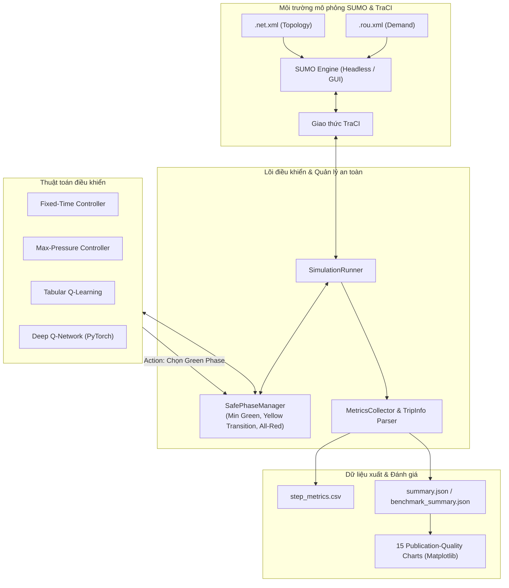

# TrafficSignalControl: SUMO Reinforcement Learning & Baseline Benchmark

[](https://www.python.org/)
[](https://eclipse.dev/sumo/)
[](https://pytorch.org/)
[](file:///tests)
[](LICENSE)

Nền tảng mô phỏng và đánh giá đối chuẩn (Benchmarking) các thuật toán điều khiển tín hiệu đèn giao thông thích ứng (**Adaptive Traffic Signal Control - ATSC**) trên môi trường **Eclipse SUMO** (Simulation of Urban MObility) thông qua giao thức **TraCI**, tích hợp các kịch bản chuẩn thuộc bộ dữ liệu **RESCO** (Reinforcement Learning Benchmarks for Traffic Signal Control).

---

## Mục lục
1. [Giới thiệu & Tính năng nổi bật](#1-giới-thiệu--tính-năng-nổi-bật)
2. [Kiến trúc hệ thống](#2-kiến-trúc-hệ-thống)
3. [Các thuật toán tích hợp](#3-các-thuật-toán-tích-hợp)
4. [Tập dữ liệu chuẩn RESCO](#4-tập-dữ-liệu-chuẩn-resco)
5. [Cấu trúc thư mục dự án](#5-cấu-trúc-thư-mục-dự-án)
6. [Cài đặt & Chuẩn bị môi trường](#6-cài-đặt--chuẩn-bị-môi-trường)
7. [Hướng dẫn sử dụng CLI](#7-hướng-dẫn-sử-dụng-cli)
   - [7.1. Kiểm tra thông tin kịch bản (Dataset Inspection)](#71-kiểm-tra-thông-tin-kịch-bản-dataset-inspection)
   - [7.2. Chạy mô phỏng điều khiển (Simulation Execution)](#72-chạy-mô-phỏng-điều-khiển-simulation-execution)
     - [7.2.1. Chạy dòng lệnh không đồ họa (Headless Mode)](#721-chạy-dòng-lệnh-không-đồ-họa-headless-mode)
     - [7.2.2. Chạy giao diện trực quan với SUMO-GUI (--gui, --gui-delay)](#722-chạy-giao-diện-trực-quan-với-sumo-gui---gui---gui-delay)
   - [7.3. Huấn luyện Agent Học tăng cường (RL Training)](#73-huấn-luyện-agent-học-tăng-cường-rl-training)
   - [7.4. Đánh giá Agent độc lập (RL Evaluation)](#74-đánh-giá-agent-độc-lập-rl-evaluation)
   - [7.5. Chạy Benchmark toàn diện (Phase 6 Evaluation)](#75-chạy-benchmark-toàn-diện-phase-6-evaluation)
   - [7.6. Tổng hợp báo cáo & Tạo biểu đồ học thuật](#76-tổng-hợp-báo-cáo--tạo-biểu-đồ-học-thuật)
8. [Hệ thống cấu hình (Configuration)](#8-hệ-thống-cấu-hình-configuration)
9. [Chỉ số đánh giá (Evaluation Metrics)](#9-chỉ-số-đánh-giá-evaluation-metrics)
10. [Kiểm thử tự động (Test Suite)](#10-kiểm-thử-tự-động-test-suite)
11. [Khắc phục sự cố thường gặp (Troubleshooting)](#11-khắc-phục-sự-cố-thường-gặp-troubleshooting)

---

## 1. Giới thiệu & Tính năng nổi bật

- **Tích hợp 4 thuật toán chuẩn mực**: Hỗ trợ 2 phương pháp kinh điển (**Fixed-Time**, **Max-Pressure**) và 2 phương pháp Học tăng cường (**Tabular Q-Learning**, **Deep Q-Network - DQN**).
- **Hỗ trợ giao diện đồ họa SUMO-GUI trực quan**: Chuyển đổi linh hoạt giữa chế độ dòng lệnh Headless tốc độ cao (benchmark, training) và chế độ trực quan **SUMO-GUI** (`--gui`, `--gui-delay`) để xem từng xe di chuyển, chuyển làn và chu kỳ đèn giao thông theo thời gian thực.
- **Bộ quản lý an toàn pha đèn (Safe Phase Manager)**: Tự động chèn pha vàng dọn nút (*Yellow clearance transition*) và pha đỏ toàn phần (*All-red clearance*), đảm bảo thời gian đèn xanh tối thiểu (`min_green >= 5s`) ngăn ngừa chuyển pha đột ngột gây tai nạn trong mô phỏng.
- **Phân tách nhịp điều khiển (Decoupled Cadence)**: Tách biệt nhịp quyết định của baseline (1.0s để tránh hiện tượng dãn chu kỳ) và agent RL (5.0s theo chuẩn RESCO).
- **Thu thập dữ liệu thực tế chính xác (Ground-truth Tripinfo)**: Phân tích trực tiếp tệp `--tripinfo-output` chuẩn của SUMO để đo lường thời gian trễ, thời gian chờ, quãng đường di chuyển và vận tốc thực tế của từng phương tiện.
- **Hệ thống đánh giá khoa học & Tự động hóa**: Khung thực nghiệm ma trận đa kịch bản, đa thuật toán, đa seed (42, 101, 2024); xác thực toàn vẹn bằng SHA-256 fingerprint; thống kê mẫu không chệch ($ddof=1$) và tự động sinh 15 biểu đồ chuẩn công bố khoa học.
- **Chất lượng mã nguồn & Kiểm thử toàn diện**: 174 kiểm thử tự động với `pytest` bao quát 100% các thành phần logic, an toàn và biên mô phỏng.

---

## 2. Kiến trúc hệ thống



---

## 3. Các thuật toán tích hợp

| Thuật toán | Loại thuật toán | Đặc điểm & Cơ chế hoạt động | Nhịp quyết định (Cadence) |
| :--- | :--- | :--- | :--- |
| **Fixed-Time** | Rule-based (Baseline) | Chu kỳ pha cố định luân phiên tuần hoàn theo thời gian đèn xanh định trước (mặc định 30.0s). Chuyển pha an toàn với vàng/đỏ dọn nút. | 1.0s |
| **Max-Pressure** | Heuristic / Pressure | Tối ưu hóa chênh lệch áp lực hàng đợi giữa các làn vào (*incoming*) và làn ra (*outgoing*). Chọn pha có áp lực giải tỏa lớn nhất, đảm bảo `min_green`. | 1.0s |
| **Tabular Q-Learning** | Học tăng cường dạng bảng | Rời rạc hóa không gian trạng thái (pha hiện tại, thời gian xanh hiệu dụng, hàng đợi phục vụ/chờ). Cập nhật bảng $Q(s, a)$ với chiến lược $\varepsilon$-greedy và đánh giá greedy định kỳ. | 5.0s |
| **Deep Q-Network (DQN)** | Học tăng cường sâu (Deep RL) | Xấp xỉ hàm giá trị $Q(s, a)$ bằng mạng MLP (PyTorch) với Replay Buffer, Target Network định kỳ, hàm mất mát Huber Loss, Gradient Clipping và Action Masking an toàn. | 5.0s |

---

## 4. Tập dữ liệu chuẩn RESCO

Dự án tinh gọn và chuẩn hóa **4 kịch bản trọng tâm** từ bộ dữ liệu [Pi-Star-Lab/RESCO](https://github.com/Pi-Star-Lab/RESCO) nhằm tối ưu hiệu năng tính toán và đại diện cho các mô hình hình học nút giao khác nhau:

| Tên Dataset | Số nút giao (TLS) | Số pha xanh | Tổng lưu lượng (Trips) | Mô tả mạng lưới | Giấy phép |
| :--- | :---: | :---: | :---: | :--- | :--- |
| `cologne1` | 1 | 4 | 2,015 | Nút giao đơn thực tế tại Cologne (TAPAS Cologne) | CC BY-NC-SA 3.0 |
| `ingolstadt1` | 1 | 3 | 1,716 | Nút giao đơn thực tế tại Ingolstadt (InTAS) | GNU GPL v3.0 |
| `cologne3` | 3 | Phức hợp | 4,494 | Tuyến phố gồm 3 nút giao liên tiếp phối hợp | CC BY-NC-SA 3.0 |
| `grid4x4` | 16 | 4 mỗi nút | Đa luồng | Mạng lưới ô cờ 4x4 gồm 16 nút giao đồng nhất | CC BY-NC-SA 4.0 |

> [!NOTE]
> Chi tiết về nguồn gốc, bản quyền commit SHA và quy trình xác thực dữ liệu được lưu trữ tại [`data/SOURCES.md`](file:///data/SOURCES.md).

---

## 5. Cấu trúc thư mục dự án

```text
TrafficSignalControl/
├── configs/                     # Cấu hình huấn luyện và thử nghiệm (YAML)
│   ├── dqn.yaml                 # Cấu hình siêu tham số Deep Q-Network
│   ├── q_learning.yaml          # Cấu hình siêu tham số Tabular Q-Learning
│   └── experiments.yaml         # Cấu hình kịch bản và tham số benchmark
├── data/                        # Tập dữ liệu RESCO SUMO (.net.xml, .rou.xml, .sumocfg)
│   ├── cologne1/                # Kịch bản Cologne 1 nút giao
│   ├── cologne3/                # Kịch bản Cologne 3 nút giao
│   ├── ingolstadt1/             # Kịch bản Ingolstadt 1 nút giao
│   ├── grid4x4/                 # Kịch bản lưới bàn cờ 16 nút giao
│   └── SOURCES.md               # Tài liệu bản quyền và nguồn dữ liệu
├── models/                      # Trọng lượng mô hình đã huấn luyện (.json, .pt)
│   ├── dqn/                     # Checkpoints DQN
│   └── q_learning/              # Checkpoints Q-Learning
├── results/                     # Kết quả thực nghiệm, biểu đồ, bảng tổng hợp
│   ├── evaluation/              # Dữ liệu benchmark đa seed (benchmark_runs.csv, ...)
│   └── figures/                 # 15 biểu đồ so sánh chất lượng học thuật (.png)
├── src/                         # Mã nguồn chính của nền tảng
│   ├── controllers/             # Các bộ điều khiển tín hiệu đèn giao thông
│   │   ├── base.py              # Lớp BaseTrafficController trừu tượng
│   │   ├── fixed_time.py        # Bộ điều khiển Fixed-Time
│   │   ├── max_pressure.py      # Bộ điều khiển Max-Pressure
│   │   ├── q_learning.py        # Bộ điều khiển Tabular Q-Learning
│   │   └── dqn.py               # Bộ điều khiển Deep Q-Network
│   ├── evaluation/              # Module đánh giá & đối chuẩn benchmark
│   │   ├── compare_algorithms.py# Tổng hợp kết quả & xuất báo cáo Markdown
│   │   ├── evaluate_rl.py       # Đánh giá agent RL độc lập
│   │   ├── experiment_runner.py # Trình thực thi benchmark ma trận đa seed (Phase 6)
│   │   └── plot_comparison.py   # Bộ sinh 15 biểu đồ trực quan hóa học thuật
│   ├── experiments/             # Module thí nghiệm baseline (Phase 4)
│   │   ├── plot_metrics.py      # Vẽ biểu đồ chuỗi thời gian metric
│   │   └── run_experiments.py   # Chạy thực nghiệm tự động cho baseline
│   ├── rl/                      # Thành phần môi trường Học tăng cường
│   │   ├── discretization.py    # Rời rạc hóa không gian trạng thái
│   │   ├── environment.py       # Môi trường Gymnasium-compatible RL Env
│   │   ├── observations.py      # Bộ trích xuất và chuẩn hóa vector quan sát
│   │   ├── replay_buffer.py     # Bộ nhớ Replay Buffer cho DQN
│   │   └── rewards.py           # Các hàm phần thưởng giao thông
│   ├── training/                # Pipeline huấn luyện RL
│   │   ├── train_dqn.py         # Huấn luyện Deep Q-Network
│   │   └── train_q_learning.py  # Huấn luyện Tabular Q-Learning
│   ├── config.py                # Nạp và xác thực cấu hình mô phỏng
│   ├── data_inspector.py        # Phân tích cú pháp mạng và luồng xe RESCO
│   ├── metrics.py               # Thu thập chỉ số và phân tích tripinfo
│   ├── phase_manager.py         # Quản lý an toàn chuyển pha đèn giao thông
│   └── runner.py                # Điều phối vòng lặp mô phỏng SUMO/TraCI
├── tests/                       # Bộ kiểm thử tự động (173 test cases)
├── main.py                      # Điểm vào chính (CLI) của ứng dụng
├── requirements.txt             # Danh sách thư viện Python phụ thuộc
└── README.md                    # Tài liệu hướng dẫn sử dụng dự án
```

---

## 6. Cài đặt & Chuẩn bị môi trường

### 6.1. Yêu cầu hệ thống
- **Hệ điều hành:** Windows 10/11 hoặc Linux (Ubuntu 20.04+)
- **Python:** Phiên bản 3.11 trở lên
- **SUMO:** Phiên bản 1.28.0+

### 6.2. Cài đặt Eclipse SUMO & Thiết lập biến môi trường
Tải và cài đặt SUMO từ trang chính thức [Eclipse SUMO Download](https://eclipse.dev/sumo/).

**Trên Windows (PowerShell):**
```powershell
# Kiểm tra SUMO đã được nhận diện trong PATH chưa
sumo --version

# Nếu chưa cấu hình biến môi trường SUMO_HOME:
[System.Environment]::SetEnvironmentVariable('SUMO_HOME', 'C:\Program Files (x86)\Eclipse\Sumo', 'User')
$env:SUMO_HOME = "C:\Program Files (x86)\Eclipse\Sumo"
```

**Trên Linux:**
```bash
sudo add-apt-repository ppa:sumo/stable
sudo apt-get update
sudo apt-get install sumo sumo-tools sumo-doc
export SUMO_HOME="/usr/share/sumo"
```

### 6.3. Khởi tạo môi trường ảo Python & Cài đặt thư viện
```powershell
# 1. Tạo môi trường ảo Python
python -m venv .venv

# 2. Kích hoạt môi trường ảo
# Trên Windows PowerShell:
.\.venv\Scripts\Activate.ps1
# Trên Linux/macOS:
source .venv/bin/activate

# 3. Nâng cấp pip và cài đặt dependencies
pip install --upgrade pip
pip install -r requirements.txt
```

---

## 7. Hướng dẫn sử dụng CLI

Giao diện dòng lệnh [`main.py`](file:///main.py) hỗ trợ đầy đủ các tham số điều khiển và chạy mô phỏng.

### 7.1. Kiểm tra thông tin kịch bản (Dataset Inspection)
Trích xuất thông tin cấu hình mạng, danh sách nút giao, số pha đèn và tổng nhu cầu luồng xe:
```powershell
# Kiểm tra một kịch bản cụ thể
python main.py --inspect --dataset cologne1
python main.py --inspect --dataset ingolstadt1

# Kiểm tra tổng quan toàn bộ 4 kịch bản có sẵn
python main.py --inspect-all
```

### 7.2. Chạy mô phỏng điều khiển (Simulation Execution)

Nền tảng hỗ trợ 2 chế độ vận hành: **Headless (mặc định)** để chạy nền tốc độ cao và **SUMO-GUI (`--gui`)** để theo dõi trực quan mô phỏng.

#### 7.2.1. Chạy dòng lệnh không đồ họa (Headless Mode)
Chế độ mặc định tối ưu hiệu năng tính toán, thích hợp cho benchmark và xử lý hàng loạt:

##### A. Thuật toán Fixed-Time (Đèn xanh cố định 30s):
```powershell
python main.py --dataset cologne1 --algorithm fixed-time --fixed-time-green 30.0 --tripinfo
```

##### B. Thuật toán Max-Pressure (Áp lực hàng đợi):
```powershell
python main.py --dataset ingolstadt1 --algorithm max-pressure --pressure-metric queue --tripinfo
```

##### C. Agent Học tăng cường (Q-Learning / DQN) với checkpoint:
```powershell
# Chạy Q-Learning với checkpoint đã huấn luyện
python main.py --dataset cologne1 --algorithm q-learning --model models/q_learning/q_learning_cologne1_best.json --tripinfo

# Chạy DQN với checkpoint đã huấn luyện
python main.py --dataset ingolstadt1 --algorithm dqn --model models/dqn/dqn_ingolstadt1_best.pt --tripinfo
```

---

#### 7.2.2. Chạy giao diện trực quan với SUMO-GUI (`--gui`, `--gui-delay`)
Thêm cờ `--gui` vào bất kỳ lệnh nào của `main.py` để mở trực tiếp cửa sổ mô phỏng **SUMO-GUI**.

> [!TIP]
> **Điều chỉnh tốc độ hiển thị mô phỏng:**
> - Mặc định TraCI chạy ở tốc độ CPU tối đa khiến các xe lướt qua rất nhanh. Thêm cờ `--gui-delay <ms>` (ví dụ `--gui-delay 50` hoặc `100` ms) để làm chậm nhịp hiển thị giữa các bước mô phỏng, giúp quan sát các pha đèn đổi màu và dòng xe di chuyển mượt mà.
> - Bạn cũng có thể điều chỉnh trực tiếp ô **Delay (ms)** ở thanh công cụ góc trên của cửa sổ SUMO-GUI bất kỳ lúc nào khi đang chạy.

##### A. Xem mô phỏng Fixed-Time trên SUMO-GUI:
```powershell
python main.py --dataset cologne1 --algorithm fixed-time --gui --gui-delay 50 --steps 500
```

##### B. Xem mô phỏng Max-Pressure trên SUMO-GUI:
```powershell
python main.py --dataset ingolstadt1 --algorithm max-pressure --gui --gui-delay 50 --steps 500
```

##### C. Xem agent Học tăng cường (Q-Learning / DQN) điều khiển trên SUMO-GUI:
```powershell
# Xem agent Q-Learning trên kịch bản cologne1
python main.py --dataset cologne1 --algorithm q-learning --model models/q_learning/q_learning_cologne1_best.json --gui --gui-delay 50

# Xem agent DQN trên kịch bản ingolstadt1
python main.py --dataset ingolstadt1 --algorithm dqn --model models/dqn/dqn_ingolstadt1_best.pt --gui --gui-delay 50
```

##### D. Thử nghiệm nhanh agent RL chưa huấn luyện (`--allow-untrained`):
```powershell
python main.py --dataset cologne1 --algorithm dqn --allow-untrained --steps 300 --gui --gui-delay 50
```

##### E. Đánh giá độc lập mô hình RL kèm giao diện đồ họa GUI (`evaluate_rl`):
```powershell
python -m src.evaluation.evaluate_rl --dataset ingolstadt1 --algo dqn --model models/dqn/dqn_ingolstadt1_best.pt --gui --gui-delay 50
```

---

### 7.3. Huấn luyện Agent Học tăng cường (RL Training)

Hệ thống huấn luyện hỗ trợ cấu hình qua file YAML, tự động nạp siêu tham số, phân tách RNG state và chạy đánh giá Greedy định kỳ (`--val-interval`) trên seed độc lập để lưu lại mô hình tốt nhất (`*_best.pt`, `*_best.json`):

#### A. Huấn luyện Deep Q-Network (DQN):
```powershell
# Huấn luyện kịch bản ingolstadt1 (15 episodes, nạp file YAML)
python -m src.training.train_dqn --dataset ingolstadt1 --config configs/dqn.yaml --episodes 15

# Huấn luyện kịch bản cologne1 với ghi đè siêu tham số qua CLI
python -m src.training.train_dqn --dataset cologne1 --config configs/dqn.yaml --episodes 20 --lr 0.0005 --gamma 0.99
```

#### B. Huấn luyện Tabular Q-Learning:
```powershell
# Huấn luyện Tabular Q-Learning trên kịch bản cologne1
python -m src.training.train_q_learning --dataset cologne1 --config configs/q_learning.yaml --episodes 15

# Huấn luyện trên ingolstadt1
python -m src.training.train_q_learning --dataset ingolstadt1 --config configs/q_learning.yaml --episodes 15
```

---

### 7.4. Đánh giá Agent độc lập (RL Evaluation)

Đánh giá chi tiết hiệu năng một checkpoint RL trong môi trường mô phỏng đầy đủ (3600s) với chế độ greedy ($\varepsilon = 0$):
```powershell
# Đánh giá checkpoint DQN
python -m src.evaluation.evaluate_rl --dataset ingolstadt1 --algo dqn --model models/dqn/dqn_ingolstadt1_best.pt --seed 42

# Đánh giá checkpoint Q-Learning
python -m src.evaluation.evaluate_rl --dataset cologne1 --algo q_learning --model models/q_learning/q_learning_cologne1_best.json --seed 42
```

---

### 7.5. Chạy Benchmark toàn diện (Phase 6 Evaluation)

Module [`src.evaluation.experiment_runner`](file:///src/evaluation/experiment_runner.py) thực thi ma trận thử nghiệm chuẩn hóa:
- **Ma trận kịch bản**: 2 kịch bản chính (`cologne1`, `ingolstadt1`) $\times$ 4 thuật toán $\times$ 3 evaluation seeds (`42`, `101`, `2024`) = **24 runs**.
- **SHA-256 Fingerprint**: Tự động nhận diện cấu hình và checkpoint để bỏ qua các lượt chạy đã hoàn thành trước đó (hỗ trợ Resume).
- **Thống kê mẫu chuẩn**: Tính trung bình và độ lệch chuẩn mẫu với bậc tự do $ddof=1$.

```powershell
# Chạy toàn bộ ma trận 24 thực nghiệm (tự động bỏ qua lượt đã có)
python -m src.evaluation.experiment_runner --run-all

# Chạy mới từ đầu, không nạp lại kết quả cũ
python -m src.evaluation.experiment_runner --run-all --fresh

# Chạy thử nghiệm một tổ hợp đơn lẻ
python -m src.evaluation.experiment_runner --scenario ingolstadt1 --algorithm DQN --seed 42
```

Kết quả được tự động tổng hợp vào:
- `results/evaluation/benchmark_runs.csv`: Dữ liệu bảng chi tiết từng lượt chạy.
- `results/evaluation/benchmark_summary.json`: Bảng thống kê tóm tắt (Mean ± Std, tỷ lệ cải thiện so với Fixed-Time).

---

### 7.6. Tổng hợp báo cáo & Tạo biểu đồ học thuật

#### A. Xuất báo cáo so sánh Markdown:
```powershell
python -m src.evaluation.compare_algorithms
```
Báo cáo đối chuẩn được xuất tại `results/evaluation/benchmark_comparison.md`.

#### B. Sinh 15 biểu đồ chuẩn công bố khoa học (Publication Quality):
```powershell
python -m src.evaluation.plot_comparison
```
Toàn bộ biểu đồ định dạng 300 DPI sẽ được lưu tại `results/figures/`:
- **Nhóm A (Comparative Bar Charts with Error Bars)**:
  - Thời gian chờ trung bình (`*_mean_waiting_time.png`)
  - Độ dài hàng đợi trung bình (`*_mean_queue_length.png`)
  - Thông lượng xe hoàn thành hành trình (`*_throughput.png`)
  - Tổn thất thời gian trung bình (`*_mean_time_loss.png`)
  - Tỷ lệ hoàn thành hành trình (`*_completion_rate.png`)
  - Tỷ lệ phần trăm cải thiện so với Fixed-Time (`*_improvement_pct.png`)
- **Nhóm B (Traffic Dynamics Over Time)**:
  - Diễn biến hàng đợi theo thời gian (`*_queue_over_time.png`)
  - Số lượng xe đang lưu thông trên mạng lưới (`*_running_vehicles.png`)
  - Số lượng xe hoàn thành tích lũy (`*_cumulative_completed.png`)
  - Phân bổ tỷ lệ thời gian đèn xanh giữa các pha (`*_green_time_distribution.png`)
- **Nhóm C (RL Learning Dynamics)**:
  - Đường cong hội tụ phần thưởng Q-Learning (`*_q_learning_reward.png`)
  - Đường cong hội tụ phần thưởng DQN (`*_dqn_reward.png`)
  - Diễn biến hàm mất mát Huber Loss của DQN (`*_dqn_loss.png`)
  - Lịch trình suy giảm $\varepsilon$-greedy exploration (`*_epsilon_schedule.png`)

---

## 8. Hệ thống cấu hình (Configuration)

Các tệp cấu hình YAML được đặt tại thư mục [`configs/`](file:///configs):

### Cấu hình DQN (`configs/dqn.yaml`):
```yaml
algorithm: DQN
decision_interval: 5.0      # Khoảng thời gian giữa các bước ra quyết định (giây)
min_green: 5.0              # Thời gian đèn xanh tối thiểu (giây)
yellow_duration: 3.0        # Thời gian pha vàng chuyển tiếp (giây)
all_red_duration: 0.0       # Thời gian toàn đỏ dọn nút (giây)

network:
  hidden_dim: 128           # Kích thước lớp ẩn
  activation: ReLU          # Hàm kích hoạt
  num_layers: 2             # Số lớp ẩn

hyperparameters:
  learning_rate: 0.001      # Tốc độ học (Adam)
  gamma: 0.95               # Hệ số chiết khấu phần thưởng
  epsilon_start: 1.0        # Giá trị epsilon khởi đầu
  epsilon_min: 0.05         # Giá trị epsilon tối thiểu
  epsilon_decay: 0.85       # Tỷ lệ phân rã epsilon sau mỗi episode
  buffer_size: 20000        # Dung lượng Replay Buffer
  batch_size: 32            # Kích thước mini-batch
  learning_starts: 64       # Số bước tích lũy trước khi bắt đầu cập nhật mạng
  target_update_interval: 100 # Chu kỳ đồng bộ trọng số sang Target Network (bước)
  max_grad_norm: 10.0       # Giới hạn chuẩn gradient (Gradient Clipping)
  num_episodes: 15          # Số episode huấn luyện
  seed: 42

observation:
  max_queue_scale: 20.0     # Hằng số chuẩn hóa độ dài hàng đợi
  max_time_scale: 60.0      # Hằng số chuẩn hóa thời gian pha xanh

reward:
  name: NegativeAverageQueueReward # Hàm thưởng phạt hàng đợi trung bình
  scale: 1.0
```

---

## 9. Chỉ số đánh giá (Evaluation Metrics)

Hệ thống tính toán và đối chuẩn các chỉ số hiệu năng then chốt:

1. **Mean Waiting Time ($s$)**: Thời gian chờ đợi trung bình của các phương tiện (vận tốc $< 0.1\text{ m/s}$).
2. **Mean Time Loss ($s$)**: Tổng thời gian bị trễ do điều kiện giao thông và dừng đỗ so với tốc độ di chuyển lý tưởng.
3. **Mean Queue Length ($\text{veh}$)**: Số lượng xe trung bình đang dừng chờ trên toàn bộ các làn tiếp cận nút giao.
4. **Throughput ($\text{veh}$)**: Tổng số phương tiện hoàn thành chuyến đi và rời khỏi mạng lưới thành công.
5. **Completion Rate ($\%$)**: Tỷ lệ phần trăm phương tiện hoàn thành so với tổng nhu cầu luồng xe trong tệp `.rou.xml`:
   $$\text{Completion Rate} = \frac{\text{Completed Vehicles}}{\text{Ground Truth Total Demand}} \times 100\%$$
6. **Improvement over Baseline ($\%$)**: Phần trăm giảm thiểu thời gian chờ hoặc hàng đợi so với Fixed-Time:
   $$\text{Improvement} = \frac{\text{Metric}_{\text{Fixed-Time}} - \text{Metric}_{\text{Target}}}{\text{Metric}_{\text{Fixed-Time}}} \times 100\%$$

---

## 10. Kiểm thử tự động (Test Suite)

Dự án áp dụng quy trình kiểm thử nghiêm ngặt bao quát toàn bộ logic xử lý, từ đơn vị thành phần đến tích hợp SUMO TraCI:

```powershell
# Chạy toàn bộ 174 test cases
pytest -q

# Chạy có hiển thị chi tiết tên từng bài test
pytest -v

# Chạy kiểm thử cho riêng module runner hoặc phase manager
pytest tests/test_runner.py tests/test_phase_manager.py
```

### Các nhóm kiểm thử chính:
- **Phase Manager & Safety Constraints**: Kiểm tra quy tắc sinh pha vàng (`build_yellow_state`), khóa thời gian xanh tối thiểu, xử lý chu kỳ pha an toàn.
- **Controllers**: Kiểm tra tính đúng đắn của giải thuật Fixed-Time, tính toán áp lực của Max-Pressure, bảng tra cứu Q-Learning và mạng Deep Q-Network.
- **RL Environment & Components**: Kiểm tra chuẩn Gymnasium, Observation Builder, State Discretizer, Replay Buffer và hàm Reward.
- **Audit & Regression Test Suites (`v2` đến `v13`)**: Bảo đảm tính tương thích ngược, phân tách nhịp điều khiển 1.0s vs 5.0s, xác thực tham số checkpoint và bắt lỗi CLI an toàn.

---

## 11. Khắc phục sự cố thường gặp (Troubleshooting)

### 1. Lỗi `sumo: command not found` hoặc `SUMO_HOME is not set`
- **Nguyên nhân**: SUMO chưa được cài đặt hoặc biến môi trường `SUMO_HOME` chưa được thiết lập.
- **Khắc phục**: Cài đặt SUMO từ trang chủ và thiết lập biến môi trường trỏ đến thư mục cài đặt SUMO (ví dụ: `C:\Program Files (x86)\Eclipse\Sumo`). Đảm bảo thư mục con `bin` đã nằm trong biến `PATH`.

### 2. Lỗi `ImportError: PyTorch is required to run DQN controller`
- **Nguyên nhân**: Môi trường hiện tại chưa kích hoạt `.venv` hoặc chưa cài đặt thư viện `torch`.
- **Khắc phục**: Kích hoạt môi trường ảo:
  ```powershell
  .\.venv\Scripts\Activate.ps1
  pip install torch
  ```

### 3. Lỗi `Q-Learning model checkpoint not found` khi chạy CLI
- **Nguyên nhân**: Khi chỉ định `--algorithm q-learning` hoặc `--algorithm dqn` mà không truyền `--model`, hệ thống sẽ tìm kiếm checkpoint mặc định trong thư mục `models/`.
- **Khắc phục**: Cung cấp đường dẫn chính xác qua `--model <path>` hoặc truyền thêm cờ `--allow-untrained` nếu muốn thử nghiệm với agent ngẫu nhiên chưa qua huấn luyện.

### 4. Xung đột cổng kết nối TraCI (`Socket error / Connection refused`)
- **Nguyên nhân**: Một tiến trình SUMO trước đó bị treo hoặc tắt không đúng cách vẫn đang chiếm dụng cổng socket.
- **Khắc phục**: Tắt các tiến trình SUMO đang chạy ngầm trên máy:
  ```powershell
  # Trên Windows:
  Stop-Process -Name sumo, sumo-gui -ErrorAction SilentlyContinue
  # Trên Linux:
  pkill -9 sumo
  ```

### 5. Cửa sổ SUMO-GUI tự động tắt ngay khi mô phỏng vừa chạy xong
- **Nguyên nhân**: Theo mặc định khi chạy hết số bước `--steps` hoặc chạm mốc kết thúc kịch bản, tiến trình TraCI sẽ tự động đóng kết nối và thoát cửa sổ GUI.
- **Khắc phục**: 
  - Thêm cờ `--gui-delay 50` hoặc `--gui-delay 100` để làm chậm tốc độ hiển thị giữa các bước, giúp quan sát lâu hơn.
  - Tăng số bước `--steps` (ví dụ `--steps 1000`) hoặc không truyền `--steps` để chạy toàn bộ thời lượng kịch bản (3600s).
  - Có thể bấm nút **Pause** trên giao diện SUMO-GUI bất kỳ lúc nào để tạm dừng và phóng to thu nhỏ kiểm tra các nút giao.

### 6. Không tìm thấy tệp thực thi `sumo-gui`
- **Nguyên nhân**: Bản cài đặt SUMO là bản tối giản (chỉ có dòng lệnh `sumo`) hoặc thiếu tệp `sumo-gui.exe`.
- **Khắc phục**: Kiểm tra trong terminal lệnh `sumo-gui --version`. Nếu chưa có, hãy cài đặt gói đầy đủ của Eclipse SUMO từ trang chủ chính thức (trên Windows chọn bộ cài đặt MSI tiêu chuẩn).
