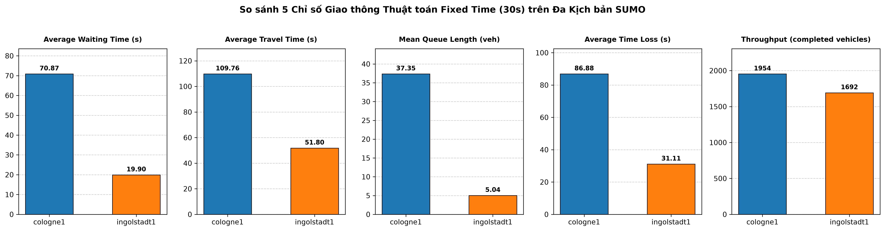

# Báo Cáo Phân Tích Chuyên Sâu: Đánh Giá Hiệu Năng Thuật Toán Điều Khiển Đèn Tín Hiệu Chu Kỳ Cố Định (Fixed-Time 30s) trên SUMO

## 1. Tổng Quan Thực Nghiệm & Thiết Lập Mô Phỏng

Báo cáo này trình bày kết quả thực nghiệm và đánh giá chuyên sâu hiệu năng của thuật toán điều khiển đèn tín hiệu giao thông chu kỳ cố định (**Fixed-Time Signal Control** với thời lượng pha xanh $30\text{s}$) trên hai kịch bản mô phỏng mạng lưới giao thông thực tế 1 nút giao từ bộ dữ liệu chuẩn của Eclipse SUMO:
- **cologne1**: Nút giao 4 nhánh tại thành phố Köln, CHLB Đức. Mô phỏng giờ cao điểm buổi sáng (07:00 - 08:00, 3.600 bước mô phỏng, 2.015 phương tiện).
- **ingolstadt1**: Nút giao phức hợp tại thành phố Ingolstadt, CHLB Đức. Mô phỏng giờ cao điểm buổi chiều (16:00 - 17:00, 3.600 bước mô phỏng, 1.716 phương tiện).

### Quy tắc Điều Khiển & Ràng Buộc Vận Hành:
- **Thời lượng Pha Xanh Cố Định (Fixed Green Duration):** $30.0\text{ giây}$ cho mỗi pha xanh chính.
- **Thời lượng Pha Vàng An Toàn (Yellow Clearance):** $3.0\text{ giây}$ chuyển tiếp giữa các pha xung đột nhằm triệt tiêu điểm nguy hiểm và bảo đảm an toàn giao thông theo quy chuẩn kỹ thuật.
- **Giao Thức Điều Khiển:** Điều khiển thời gian thực qua giao thức TraCI (`traci.trafficlight.setRedYellowGreenState`), đồng bộ dữ liệu song song với module thu thập chỉ số tự động từ tệp `--tripinfo-output` XML của SUMO.
- **Tiêu Chuẩn Tính Toán Hàng Đợi (Queue Length):** Phương tiện có vận tốc tức thời $v < 0.1\text{ m/s}$ trên các làn vào (incoming lanes) của nút giao.

---

## 2. Bảng Tổng Hợp Kết Quả Thực Nghiệm (5 Chỉ Số Cốt Lõi)

## Bảng So sánh Hiệu năng Điều khiển Đèn Giao thông (Fixed Time - 30s Green)

| Metric | Unit | cologne1 | ingolstadt1 | Mô tả |
| :--- | :--- |:---: |:---: |:--- |
| **Average Waiting Time** | s | `70.87` | `19.90` | Thời gian dừng chờ trung bình (v < 0.1 m/s) |
| **Average Travel Time** | s | `109.76` | `51.80` | Thời gian hành trình trung bình từ xuất phát đến đích |
| **Mean Queue Length** | veh | `37.35` | `5.04` | Độ dài hàng đợi trung bình trên các nhánh vào nút |
| **Average Time Loss** | s | `86.88` | `31.11` | Thời gian tổn thất trung bình so với điều kiện lý tưởng |
| **Throughput** | veh | `1954` | `1692` | Số lượng phương tiện hoàn thành hành trình |
| **Simulation Steps** | step | `3600` | `3600` | Tổng số bước mô phỏng thực tế |

---

## 3. Phân Tích Chuyên Sâu: Lưu Lượng Đối Xứng (Symmetric) vs Bất Đối Xứng (Asymmetric)

Đặc tính dòng phương tiện và cấu trúc pha tại nút giao là hai yếu tố quyết định trực tiếp tới hiệu năng của thuật toán điều khiển chu kỳ cố định:

### 3.1. Kịch bản `cologne1`: Thất Bại Trước Dòng Lưu Lượng Bất Đối Xứng Nặng Nề
- **Bản chất dòng lưu lượng:**
  - `cologne1` thể hiện mức độ bất đối xứng cực lớn giữa các hướng tiếp cận.
  - Trục chính Đông - Tây gánh phần lớn lưu lượng: Nhánh `23429231#1` tiếp nhận **688 xe (34.1%)** và nhánh `-32038056#3` tiếp nhận **572 xe (28.4%)**. Tổng cộng hai nhánh này chiếm tới **62.5%** tổng nhu cầu toàn nút.
  - Ngược lại, các nhánh phụ có lưu lượng rất thấp: Nhánh `27115123#3` chỉ có **204 xe (10.1%)**, và nhánh `130165204` chỉ có **112 xe (5.6%)**. Tỷ lệ chênh lệch lưu lượng giữa nhánh chính và nhánh phụ lên tới **3.37 lần**.
- **Cấu trúc pha và chu kỳ đèn:**
  - Nút giao tại `cologne1` có tới **8 pha xanh riêng biệt** (phục vụ rẽ trái bảo vệ, đi thẳng, và rẽ phải cho từng nhánh).
  - Với chính sách cố định 30s xanh + 3s vàng cho mỗi pha, chu kỳ đèn tổng cộng bị kéo dài tới:
    $$C_{\text{cologne1}} = 8 \times (30\text{s} + 3\text{s}) = 264\text{ giây (tương đương 4 phút 24 giây)}$$
  - Chu kỳ quá dài ($264\text{s}$) kết hợp với phân bổ thời gian xanh cào bằng ($30\text{s}$ cho mọi pha) là nguyên nhân chí mạng khiến phương tiện trên các nhánh chính phải chịu thời gian đèn đỏ lên đến hơn $200\text{s}$ trong mỗi chu kỳ.
  - **Hậu quả:** Thời gian chờ trung bình vọt lên **70.87s**, thời gian hành trình đạt **109.76s**, và thời gian tổn thất trung bình lên đến **86.88s** (chiếm gần 80% thời gian di chuyển).

### 3.2. Kịch bản `ingolstadt1`: Hiệu Quả Tốt Nhờ Lưu Lượng Đối Xứng & Chu Kỳ Tinh Gọn
- **Bản chất dòng lưu lượng:**
  - Nhu cầu giao thông phân bố tương đối đồng đều (đối xứng) giữa các hướng tiếp cận chính:
    - Nhánh `201963537#1`: **620 xe (36.1%)**
    - Nhánh `104010354`: **463 xe (27.0%)**
    - Nhánh `653473569#5`: **421 xe (24.5%)**
    - Nhánh `25149219#1`: **212 xe (12.4%)**
- **Cấu trúc pha và chu kỳ đèn:**
  - Nút giao chỉ có **3 pha xanh chính**, trong đó pha đầu tiên (`GGgGrGGG`) cho phép giải tỏa đồng thời nhiều luồng không xung đột.
  - Chu kỳ đèn tổng cộng chỉ kéo dài:
    $$C_{\text{ingolstadt1}} = 3 \times (30\text{s} + 3\text{s}) = 99\text{ giây (~1 phút 39 giây)}$$
  - Nhờ chu kỳ ngắn và các luồng xe tương đối cân bằng, thời gian chờ đèn đỏ tối đa của một phương tiện hiếm khi vượt quá $66\text{s}$.
  - **Hậu quả:** Thời gian chờ trung bình chỉ còn **19.90s** (giảm **71.9%** so với `cologne1`), thời gian tổn thất chỉ **31.11s** (giảm **64.2%**), và hàng đợi trung bình chỉ là **5.04 xe**.

---

## 4. Phân Tích Hiện Tượng Lãng Phí Thời Gian Xanh (Green Time Waste)

Hiện tượng lãng phí thời gian xanh xảy ra khi tín hiệu đèn giao thông tiếp tục duy trì màu xanh (green) cho một hướng tiếp cận đã hoàn toàn sạch bóng phương tiện (Hàng đợi = 0, Số xe trên làn = 0), trong khi các hướng đối diện hoặc xung đột đang chịu đèn đỏ và hình thành hàng đợi dồn ứ nghiêm trọng.

- **Đo lường Thực nghiệm Định lượng:**
  - Trong suốt 3.600 giây mô phỏng tại `cologne1`, có tổng cộng **422 giây đèn xanh bị lãng phí hoàn toàn** (chiếm **12.9%** tổng thời gian xanh thực tế) khi tất cả các làn được cấp pha xanh đều không có bất kỳ phương tiện nào lưu thông.
  - Điển hình tại Pha 5 (phục vụ nhánh phụ `27115123#3`): Lưu lượng nhánh này chỉ có khoảng 0.056 xe/giây. Trong mỗi chu kỳ $264\text{s}$, chỉ có khoảng 6-7 phương tiện đến nút. Toàn bộ số xe này được giải phóng chỉ trong vòng 8-10 giây đầu của pha xanh. Khoảng thời gian **20-22 giây còn lại của pha xanh trở thành thời gian chết (empty green time)**.
  - Sự lãng phí này là tổn thất kép: Vừa hạ thấp hiệu suất sử dụng nút giao, vừa đẩy thời gian chờ của các nhánh chính lên cao vô lý.
- **So sánh với `ingolstadt1`:**
  - Mặc dù tỷ lệ giây xanh trống tại `ingolstadt1` là **11.8%** (385 giây), nhưng sự lãng phí này mang tính ngẫu nhiên do giãn cách giữa các nhóm xe (platoon headway), chứ không phải lãng phí do mất cân đối cấu trúc pha như `cologne1`.

---

## 5. Phân Tích Hiện Tượng Tràn Hàng Đợi (Queue Spillover) & Sức Chứa Làn

Một trong những rủi ro giao thông nguy hiểm nhất của chu kỳ cố định là **Tràn hàng đợi (Queue Spillover / Spillback)** — khi độ dài hàng đợi xe dừng chờ vượt quá chiều dài vật lý của làn đường, dội ngược về nút giao phía trước hoặc phong tỏa hoàn toàn lối rẽ của các dòng xe khác.

### 5.1. So Sánh Sức Chứa Vật Lý và Đỉnh Hàng Đợi Thực Tế:
Quy chuẩn kích thước phương tiện trong mô phỏng: Chiều dài xe $4.3\text{m} +$ khoảng cách tối thiểu giữa 2 xe dừng $1.5\text{m} = 5.8\text{m/xe}$.

| Bản đồ | Làn đường vào nút | Chiều dài làn (m) | Sức chứa tối đa (xe) | Hàng đợi TB (xe) | Hàng đợi Cực đại (xe) | Tình trạng Tràn hàng đợi |
| :--- | :--- | :---: | :---: | :---: | :---: | :--- |
| **cologne1** | `23429231#1_0` | 96.6m | **16 xe** | 6.58 | **16 xe** | **BÃO HÒA 100% (Spillback)** |
| **cologne1** | `23429231#1_1` | 96.6m | **16 xe** | 5.54 | **16 xe** | **BÃO HÒA 100% (Spillback)** |
| **cologne1** | `27115123#3_0` | 41.5m | **7 xe** | 2.25 | **7 xe** | **BÃO HÒA 100%** |
| **cologne1** | `27115123#3_1` | 41.5m | **7 xe** | 2.64 | **7 xe** | **BÃO HÒA 100%** |
| **cologne1** | `28198821#3_0` | 57.2m | **9 xe** | 2.29 | **9 xe** | **BÃO HÒA 100%** |
| **cologne1** | `28198821#3_1` | 57.2m | **9 xe** | 2.79 | **10 xe** | **TRÀN HÀNG ĐỢI (> 100%)** |
| **cologne1** | `-32038056#3_0` | 351.2m | 60 xe | 8.40 | **44 xe** | Tải nặng (73% sức chứa) |
| **cologne1** | `-32038056#3_1` | 351.2m | 60 xe | 6.40 | **33 xe** | Tải nặng (55% sức chứa) |
| **ingolstadt1** | `201963537#1_1` | 143.8m | 24 xe | 0.31 | 12 xe | Bình thường (50% sức chứa) |
| **ingolstadt1** | `201963537#1_2` | 143.8m | 24 xe | 0.23 | 12 xe | Bình thường (50% sức chứa) |
| **ingolstadt1** | `201963537#1_3` | 143.8m | 24 xe | 0.75 | 13 xe | Bình thường (54% sức chứa) |
| **ingolstadt1** | `104010354_1` | 56.4m | 9 xe | 1.70 | 7 xe | Ổn định (77% sức chứa) |
| **ingolstadt1** | `104010354_2` | 56.4m | 9 xe | 1.33 | 7 xe | Ổn định (77% sức chứa) |

### 5.2. Đánh Giá Hệ Quả Spillover tại `cologne1`:
- Tại nhánh `23429231#1`, cả hai làn xe đều chạm ngưỡng kịch trần **16 xe/làn** (tổng cộng 32 xe dừng chờ xếp hàng dài hết toàn bộ đoạn đường 96.6m). Các phương tiện tiếp theo bị dồn ứ tràn sang các đoạn đường nối thượng lưu, gây tắc nghẽn dây chuyền (congestion ripple effect).
- Tại nhánh `28198821#3_1`, hàng đợi đạt **10 xe**, vượt quá chiều dài vật lý 57.2m (sức chứa 9 xe), dẫn đến tràn hàng đợi trực tiếp.
- Tổng hàng đợi toàn nút giao tại `cologne1` có thời điểm lên tới **86 xe**, cao gần gấp 3 lần mức cực đại của `ingolstadt1` (30 xe).

---

## 6. Đánh Giá Năng Lực Thông Hành (Throughput) & Tỷ Lệ Hoàn Thành

- **cologne1:** Đạt Throughput **1954 phương tiện** trên tổng số 2.015 chuyến đi (tỷ lệ hoàn thành **96.97%**). Có 61 phương tiện bị kẹt lại trong mạng lưới khi mô phỏng chạm mốc 3.600s do tắc nghẽn kéo dài trên các nhánh vào.
- **ingolstadt1:** Đạt Throughput **1692 phương tiện** trên tổng số 1.716 chuyến đi (tỷ lệ hoàn thành **98.60%**). Dòng xe lưu thoát nhanh chóng, mạng lưới giải phóng gần như triệt để.

---

## 7. Kết Luận & Định Hướng Nâng Cấp (Các Bước Tiếp Theo)

### 7.1. Đánh giá Tổng thể Thuật toán Fixed-Time (30s):
1. **Ưu điểm:**
   - Cài đặt đơn giản, ổn định, không đòi hỏi hệ thống cảm biến phức tạp hay hạ tầng TraCI nặng nề.
   - Hoạt động tương đối chấp nhận được khi lưu lượng giao thông có tính chất **đối xứng và chu kỳ pha ngắn** (dưới 100s) như tại `ingolstadt1`.
2. **Khuyết điểm nghiêm trọng:**
   - **Hoàn toàn bất lực trước lưu lượng bất đối xứng:** Gán cứng thời gian xanh bằng nhau cho cả trục chính 688 xe và nhánh phụ 204 xe.
   - **Tác động tiêu cực từ số lượng pha:** Càng nhiều pha, chu kỳ đèn $C$ càng phình to, khiến thời gian chờ của xe tăng theo cấp số nhân.
   - **Lãng phí thời gian xanh (12.9%)** và **gây tràn hàng đợi (100% sức chứa làn)**.

### 7.2. Định Hướng Phát Triển Kế Tiếp:
- **Pha thích ứng (Actuated Control / Max-Pressure):** Tự động phát hiện khoảng trống dòng xe (gap-out) để cắt sớm pha xanh rỗng, chuyển quyền ưu tiên cho làn có áp lực hàng đợi cao nhất.
- **Học Tăng Cường (Reinforcement Learning - Q-Learning, DQN, PPO):** Huấn luyện tác tử RL học chính sách điều khiển pha linh hoạt (Variable Phase Duration), tối ưu hóa hàm phần thưởng đa mục tiêu (giảm Waiting Time, triệt tiêu Queue Length và cực đại hóa Throughput).
