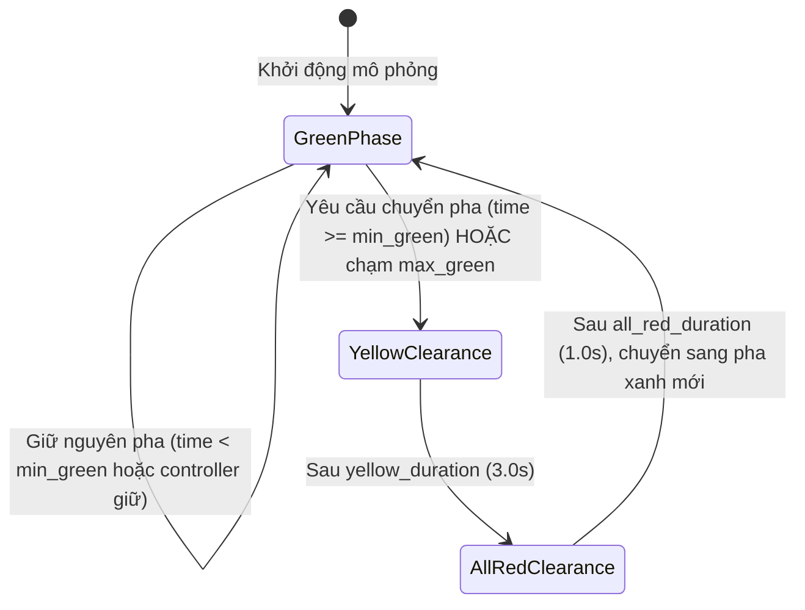

# `src/` — Kiến trúc Mã nguồn & Lõi Điều khiển ATSC

Thư mục [`src/`](file:///src) chứa toàn bộ mã nguồn chính của nền tảng mô phỏng, điều khiển tín hiệu đèn giao thông thích ứng (**ATSC**), môi trường Học tăng cường (**RL**) và hệ thống đối chuẩn khoa học (**Benchmarking**).

---

## 1. Cấu trúc thư mục & Module

```text
src/
├── controllers/             # Các thuật toán điều khiển tín hiệu đèn
│   ├── base.py              # Interface trừu tượng BaseTrafficController, dữ liệu quan sát
│   ├── fixed_time.py        # Bộ điều khiển Fixed-Time chu kỳ cố định
│   ├── max_pressure.py      # Bộ điều khiển áp lực Max-Pressure Heuristic
│   └── q_learning.py        # Bộ điều khiển Tabular Q-Learning dạng bảng
├── rl/                      # Thành phần môi trường Học tăng cường (Gymnasium-style)
│   ├── discretization.py    # Rời rạc hóa không gian trạng thái liên tục
│   ├── environment.py       # Môi trường TrafficSignalRLEnv tích hợp TraCI/libsumo
│   ├── observations.py      # Bộ trích xuất và chuẩn hóa vector quan sát
│   └── rewards.py           # Các hàm phần thưởng giao thông (NegativePressureReward)
├── training/                # Pipeline huấn luyện tác tử
│   └── train_q_learning.py  # Huấn luyện Tabular Q-Learning với validation định kỳ
├── evaluation/              # Đánh giá, đối chuẩn & kiểm toán khoa học
│   ├── compare_algorithms.py# Tổng hợp và so sánh hiệu năng các phương pháp
│   ├── eval_audit.py        # Kiểm toán tính bất biến Q-table (SHA-256 digest)
│   ├── evaluate_rl.py       # Đánh giá agent RL độc lập ở chế độ greedy
│   ├── experiment_runner.py # Trình thực thi ma trận thực nghiệm đa seed
│   ├── plot_comparison.py   # Bộ sinh biểu đồ trực quan hóa học thuật (300 DPI)
│   └── provenance.py        # Định danh siêu dữ liệu (fingerprint) tái lập kết quả
├── config.py                # Định nghĩa cấu hình mô phỏng SimulationConfig & nạp YAML
├── data_inspector.py        # Phân tích cú pháp mạng lưới .net.xml và luồng xe .rou.xml
├── metrics.py               # Thu thập chỉ số thời gian thực & phân tích TripInfo XML
├── phase_manager.py         # Bộ quản lý an toàn chuyển pha SafePhaseManager
└── runner.py                # Điều phối vòng lặp mô phỏng SUMO (libsumo / TraCI)
```

---

## 2. Chi tiết các thành phần chính

### 2.1. Lõi Điều phối & An toàn Chuyển pha (Core Simulation & Safety)

#### [`runner.py`](file:///src/runner.py) — `SimulationRunner`
- Điều phối vòng lặp mô phỏng thời gian thực với SUMO.
- **Hỗ trợ cơ chế song hành libsumo / TraCI**:
  - Tự động ưu tiên backend **`libsumo`** (C++ in-process direct binding) khi chạy chế độ Headless giúp tăng tốc độ mô phỏng gấp nhiều lần.
  - Tự động chuyển về giao thức socket **`TraCI`** khi người dùng yêu cầu đồ họa trực quan `--gui` hoặc truyền cờ `--no-libsumo`.
- Tự động trích xuất các pha đèn xanh hợp lệ (`extract_green_phases`) từ file mạng SUMO, loại bỏ các trạng thái trùng lặp hoặc chứa tín hiệu vàng.

#### [`phase_manager.py`](file:///src/phase_manager.py) — `SafePhaseManager`
- Đảm bảo tính an toàn giao thông nghiêm ngặt trong mô phỏng:
  - **Thời gian xanh tối thiểu (`min_green >= 5s`)**: Ngăn chặn tình trạng đổi pha chớp nhoáng gây bất an toàn.
  - **Thời gian xanh tối đa (`max_green <= 60s`)**: Cưỡng bức chuyển pha khi một hướng lưu thông chiếm dụng đèn xanh quá lâu gây ùn tắc cục bộ các nhánh khác.
  - **Pha vàng chuyển tiếp (`yellow_duration = 3s`)**: Tự động sinh trạng thái đèn vàng dọn nút (`build_yellow_state`) cho các luồng sắp chuyển đỏ.
  - **Pha đỏ toàn phần (`all_red_duration = 1s`)**: Đảm bảo toàn bộ nút giao dọn sạch xe trước khi mở luồng xanh mới.



#### [`metrics.py`](file:///src/metrics.py) — `MetricsCollector`
- Thu thập chỉ số hệ thống theo từng bước mô phỏng: số xe đang lưu thông (`running_vehicles`), độ dài hàng đợi (`queue_length`), thời gian chờ (`waiting_time`), xe hoàn thành hành trình (`step_completed_vehicles`).
- Tích hợp hàm `parse_tripinfo_output`: Phân tích tệp XML `--tripinfo-output` chuẩn của SUMO để trích xuất ground-truth thời gian trễ thực tế (`mean_time_loss`), thời gian chờ trung bình (`mean_waiting_time`), quãng đường và vận tốc di chuyển.

---

### 2.2. Các Bộ Điều Khiển (Traffic Controllers)

1. **Fixed-Time Controller ([`controllers/fixed_time.py`](file:///src/controllers/fixed_time.py))**:
   - Vận hành theo chu kỳ đèn xanh cố định (mặc định 30.0s mỗi pha).
   - Tự động đồng bộ lịch trình khi có sự can thiệp từ ràng buộc an toàn `max_green` và bảo toàn nhịp quyết định 1.0s.

2. **Max-Pressure Controller ([`controllers/max_pressure.py`](file:///src/controllers/max_pressure.py))**:
   - Dựa trên lý thuyết hàng đợi áp lực mạng lưới:
     $$\text{Pressure}(p) = \sum_{l \in \text{in}(p)} w(l) - \sum_{m \in \text{out}(p)} w(m)$$
   - Hỗ trợ đo lường áp lực theo độ dài hàng đợi (`queue`) hoặc tổng số lượng xe (`vehicle_count`).
   - Tích hợp cơ chế Tie-Breaking ưu tiên giữ nguyên pha hiện tại nhằm tránh chuyển pha dao động vô ích.

3. **Tabular Q-Learning Controller ([`controllers/q_learning.py`](file:///src/controllers/q_learning.py))**:
   - Bảng giá trị hành động $Q(s, a)$ với cập nhật Bellman:
     $$Q(s, a) \leftarrow Q(s, a) + \alpha \left[ r + \gamma \max_{a'} Q(s', a') - Q(s, a) \right]$$
   - Chiến lược lựa chọn hành động $\varepsilon$-greedy trong lúc huấn luyện, tự động chuyển sang thuần Greedy ($\varepsilon = 0$) trong quá trình đánh giá.
   - Hỗ trợ lưu trữ và nạp checkpoint dưới dạng file JSON trực quan.

---

### 2.3. Môi Trường Học Tăng Cường (RL Components)

- **`TrafficSignalRLEnv` ([`rl/environment.py`](file:///src/rl/environment.py))**: Môi trường tuân thủ chuẩn Gymnasium, thực thi bước quyết định đa bước (`decision_interval = 5.0s`), cung cấp danh sách hành động hợp lệ (`get_valid_actions`) tuân thủ nghiêm ngặt ràng buộc `max_green`.
- **`StateDiscretizer` ([`rl/discretization.py`](file:///src/rl/discretization.py))**: Rời rạc hóa vector trạng thái (pha hiện tại, thời gian xanh hiệu dụng chia bin, hàng đợi luồng vào phục vụ và luồng chờ) thành tuple số nguyên đại diện cho khóa của bảng Q.
- **`NegativePressureReward` ([`rl/rewards.py`](file:///src/rl/rewards.py))**: Hàm thưởng phạt dựa trên chênh lệch áp lực vào - ra và trọng số phương tiện đang chờ gia nhập mạng lưới (`pending_vehicles`), ngăn chặn hiện tượng tắc nghẽn lan truyền ngược (downstream spillback).

---

### 2.4. Kiểm Định Khoa Học & Đối Chuẩn (Provenance & Eval Audit)

- **`provenance.py` ([`evaluation/provenance.py`](file:///src/evaluation/provenance.py))**:
  - Gắn định danh duy nhất (fingerprint) cho mỗi lượt chạy thực nghiệm dựa trên tổ hợp `scenario`, `algorithm`, `seed`, và đường dẫn checkpoint.
  - Đảm bảo tính tái lập (reproducibility) và tái sử dụng an toàn các kết quả thử nghiệm hợp lệ đã lưu.

- **`eval_audit.py` ([`evaluation/eval_audit.py`](file:///src/evaluation/eval_audit.py))**:
  - Tính toán mã băm SHA-256 của toàn bộ bảng $Q(s, a)$ ngay trước và ngay sau đợt đánh giá mô phỏng.
  - Xác thực tiêu chuẩn bất biến (`invariance_pass = True`, `total_updates_before == total_updates_after`), chứng minh agent hoàn toàn không thực hiện bất kỳ bước học nào khi đánh giá đối chuẩn.
